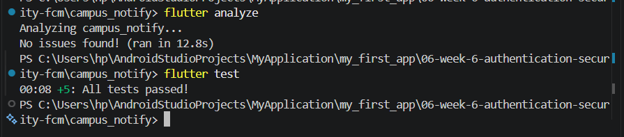
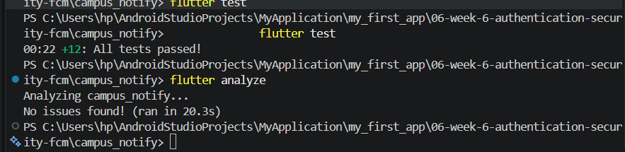

# Campus Notify 📢

Campus Notify merupakan aplikasi mobile berbasis Flutter yang digunakan untuk menyampaikan pengumuman kampus dan notifikasi secara real-time kepada mahasiswa. Aplikasi ini menggunakan **Firebase Cloud Messaging (FCM)**, **Flutter Local Notifications**, **Riverpod**, **GoRouter**, dan **Flutter Secure Storage**.

---

## 📱 Deskripsi Aplikasi & Autentikasi

### Deskripsi Aplikasi

Campus Notify memungkinkan mahasiswa menerima pengumuman kampus dan notifikasi secara real-time pada berbagai kondisi aplikasi, yaitu saat aplikasi sedang dibuka, berjalan di latar belakang, maupun dalam keadaan ditutup sepenuhnya.

### Autentikasi & Route Guard

* Token autentikasi (`access_token` dan `refresh_token`) disimpan secara aman menggunakan **FlutterSecureStorage** pada `lib/data/token_store.dart`.
* **GoRouter** digunakan untuk menerapkan perlindungan pada rute aplikasi melalui `lib/main.dart`. Pengguna yang belum terautentikasi akan diarahkan ke halaman `/login`.
* **Dio interceptor** pada `lib/data/api_client.dart` secara otomatis mencoba memperbarui JWT access token ketika menerima respons HTTP `401`.
* Jika proses pembaruan token gagal, data autentikasi yang tersimpan akan dihapus dan pengguna akan dikeluarkan dari aplikasi.

---

## 🏗️ Audit Penempatan Layer

| File                            | Layer saat ini            | Masalah                                                                                                                                       |
| ------------------------------- | ------------------------- | --------------------------------------------------------------------------------------------------------------------------------------------- |
| `pages/home_page.dart`          | presentation              | Tidak memanggil Dio langsung. Tidak ada formatting tanggal maupun parsing JSON di widget (masih berupa placeholder statis).                    |
| `data/api_client.dart`          | data                      | OK. Hanya membangun `Dio` beserta interceptor dan dipakai sebagai dependency repository, bukan dipanggil langsung dari widget.                  |
| `providers/auth_provider.dart`  | presentation (state)      | OK. Hanya memanggil `AuthRepository` dan `TokenStore`, tidak mengandung logika data/network.                                                    |
| `data/auth_repository.dart`     | data (+ kontrak tercampur)| Interface dan implementasi masih satu kelas; `AuthRepository` belum dipisah dari kontrak/abstraksinya.                                         |

---

## 🧪 Pengujian FCM pada Berbagai Kondisi Aplikasi

Fitur notifikasi FCM telah diuji pada tiga kondisi siklus hidup aplikasi menggunakan payload berikut:

```json
{"route": "/announcement/3"}
```

| **Kondisi Aplikasi** | **Hasil yang Diharapkan**                                                                                                           | **Cara Pengujian**                                                                                                  | **Status**   |
| -------------------- | ----------------------------------------------------------------------------------------------------------------------------------- | ------------------------------------------------------------------------------------------------------------------- | ------------ |
| **Foreground**       | Banner notifikasi lokal muncul. Ketika notifikasi ditekan, pengguna diarahkan ke `/announcement/3`.                                 | Buka aplikasi dan biarkan tetap berada di layar, kemudian kirim pesan FCM melalui Firebase Console atau backend.    | **BERHASIL** |
| **Background**       | Banner notifikasi sistem Android muncul. Ketika notifikasi ditekan, aplikasi terbuka dan mengarahkan pengguna ke `/announcement/3`. | Tekan tombol Home untuk menjalankan aplikasi di latar belakang, kirim pesan FCM, lalu tekan notifikasi yang muncul. | **BERHASIL** |
| **Terminated**       | Aplikasi dibuka kembali dari kondisi tertutup menggunakan `getInitialMessage()` dan langsung diarahkan ke `/announcement/3`.        | Tutup aplikasi sepenuhnya, kirim pesan FCM, lalu tekan notifikasi yang diterima.                                    | **BERHASIL** |

---

## 📸 Bukti Screenshot


## 🚀 Cara Menjalankan Aplikasi

1. Hubungkan perangkat Android fisik melalui USB dan pastikan **USB Debugging** telah diaktifkan.
2. Ambil seluruh dependency dan lakukan pemeriksaan kode dengan menjalankan:

   ```bash
   flutter pub get
   flutter analyze
   ```
3. Jalankan unit test dan widget test:

   ```bash
   flutter test
   ```
4. Build dan jalankan aplikasi pada perangkat Android yang telah terhubung:

   ```bash
   flutter run
   ```

---

## 🤖 Tools AI yang Digunakan

* **Google Antigravity AI Assistant (Gemini 3.6 Flash)**: Digunakan untuk membantu merancang arsitektur FCM, mengimplementasikan `PushService`, melakukan refactoring pada route guard, serta membuat test suite.

---

## 💬 Prompt dan Perbaikan Manual

### Prompt yang Digunakan

> *Flutter Campus Notification App. Stack: firebase_messaging, flutter_local_notifications, flutter_secure_storage, go_router, Riverpod. Generate a PushService with: requestPermission + getToken + onTokenRefresh (send to POST /devices), onMessage (show a local notification manually), onMessageOpenedApp + getInitialMessage (navigate to data.route), subscribe/unsubscribe topic campus-announcement, top-level background handler with @pragma('vm:entry-point'). Mark which parts DIFFER for Android 13+ vs iOS, and which parts must never touch BuildContext.*

### Perbaikan Manual yang Diterapkan

1. **Permission Notifikasi Android 13+ dan Desugaring**
   Menambahkan permission `<uses-permission android:name="android.permission.POST_NOTIFICATIONS"/>` pada `AndroidManifest.xml` dan mengaktifkan `isCoreLibraryDesugaringEnabled = true` pada `build.gradle.kts`.

2. **Perbaikan GoRouter untuk Deep Link**
   Memperbarui logika `redirect` pada `lib/main.dart` agar rute pengumuman publik (`/announcement/:id`) tetap dapat diakses tanpa diarahkan ke `/login`.

3. **Perbaikan Sintaks dan Callback Local Notification**
   Memperbaiki penulisan parameter `InitializationSettings` menjadi `settings:` serta menghubungkan callback `_onRouteTap` agar navigasi ke rute tujuan dapat dilakukan secara langsung ketika notifikasi ditekan.


## ⚠️ Masalah yang Ditemukan & Hasil Pengujian

### Masalah yang Ditemukan dan Diselesaikan

* **Kegagalan Build (Desugaring)**: Proses build `flutter_local_notifications` mengalami kegagalan karena konfigurasi Java 8 desugaring belum diaktifkan pada Android Gradle. Masalah ini diperbaiki melalui konfigurasi pada `build.gradle.kts`.
* **Navigasi Tidak Berjalan**: Ketika notifikasi diterima dalam kondisi foreground, penekanan pada notifikasi tidak berhasil memicu navigasi menggunakan GoRouter. Masalah ini diperbaiki dengan menerapkan `routeFromMessage` dan callback `listenForeground`.

### Verifikasi & Hasil Pengujian


## 📝 Reflection

### Q1: Mengapa refresh token tidak boleh disimpan di SharedPreferences? Apa risikonya jika token tersebut bocor?

* **Jawaban Teknis**: `SharedPreferences` pada Android menyimpan data dalam file XML yang tidak terenkripsi (`/data/data/<package>/shared_prefs/`). Jika perangkat memiliki akses root atau data dapat diambil melalui metode ekstraksi backup tertentu, token yang tersimpan dapat dibaca. Sebaliknya, `FlutterSecureStorage` menggunakan mekanisme keamanan seperti Android Keystore dan iOS Keychain untuk melindungi data sensitif.
* **Risiko Jika Bocor**: Refresh token biasanya memiliki masa berlaku yang lebih panjang, bahkan dapat mencapai beberapa minggu atau bulan. Jika penyerang memperoleh refresh token, mereka dapat menggunakannya untuk menghasilkan access token yang valid tanpa mengetahui kata sandi pengguna. Hal ini dapat menyebabkan pengambilalihan akun secara berkelanjutan.

### Q2: Apa yang terjadi jika `onTokenRefresh` diabaikan selama satu semester?

* **Jawaban Teknis**: FCM registration token dapat berubah atau menjadi tidak valid secara berkala, misalnya setelah pemulihan data aplikasi, pembaruan sistem operasi, atau perubahan pada Google Play Services.
* **Konsekuensi**: Jika perubahan token melalui `onTokenRefresh` tidak ditangani, backend dapat tetap menyimpan token lama. Akibatnya, notifikasi penting seperti informasi ujian, pengumuman nilai, atau pengingat pembayaran UKT tidak dapat diterima oleh perangkat tersebut dan dapat menghasilkan error seperti `NotRegistered` atau `UNREGISTERED`.

### Q3: Kapan menggunakan topic dan kapan menggunakan device token? Berikan masing-masing satu contoh pesan kampus.

* **Topic Messaging**: Digunakan untuk mengirim notifikasi secara massal kepada kelompok pengguna atau seluruh pengguna tanpa harus mengelola token perangkat satu per satu.

  * **Contoh**: *"Kampus Libur: Seluruh kegiatan perkuliahan ditiadakan pada hari libur nasional besok."*
  * **Topic**: `campus-announcement`

* **Device Token Messaging**: Digunakan untuk mengirim notifikasi yang bersifat spesifik, personal, atau sensitif kepada perangkat pengguna tertentu.

  * **Contoh**: *"Pemberitahuan Khusus: Pembayaran UKT Semester Genap atas nama [Nama Mahasiswa] telah diverifikasi LUNAS."*
  * **Target**: Device Token pengguna terkait.

### Q4: Bagian mana dari draft AI yang ditolak atau diperbaiki, dan mengapa?

Beberapa bagian dari draft awal AI perlu diperbaiki agar sesuai dengan kebutuhan aplikasi dan konfigurasi Android:

1. **Permission Android 13+ & Desugaring**
   Draft awal belum menambahkan `POST_NOTIFICATIONS` pada `AndroidManifest.xml` dan `isCoreLibraryDesugaringEnabled` pada konfigurasi Gradle. Tanpa konfigurasi tersebut, proses build dapat mengalami kegagalan dan notifikasi dapat tidak muncul pada perangkat Android 13+.

2. **GoRouter Guard yang Menghambat Deep Link**
   Route guard pada draft awal mengarahkan pengguna yang belum terautentikasi ke `/login`, termasuk ketika pengguna membuka deep link menuju halaman pengumuman. Logika redirect kemudian diperbaiki agar rute publik seperti `/announcement/:id` tetap dapat diakses.

3. **Callback Banner pada Kondisi Foreground**
   Terdapat masalah pada konfigurasi `InitializationSettings` dan callback ketika pengguna menekan notifikasi lokal. Perbaikan dilakukan pada sintaks parameter `InitializationSettings` dan dengan menghubungkan callback `_onRouteTap` agar penekanan notifikasi dapat menjalankan `router.go(route)` sesuai rute yang diterima.


# WEEK 07

   ## Hasil Audit Clean Architecture

Berdasarkan hasil pencarian pada project `campus_notify`, dilakukan pemeriksaan terhadap tiga pola pelanggaran Clean Architecture, yaitu akses jaringan atau database langsung dari presentation, logika bisnis di dalam fungsi `build()`, dan instansiasi dependency secara manual.

### 1. Widget Mengakses Jaringan atau Database Secara Langsung

**Hasil: 0 pelanggaran ditemukan.**

Tidak ditemukan akses jaringan atau database secara langsung pada folder presentation. Penggunaan `FlutterSecureStorage` ditemukan pada `lib/data/token_store.dart`, sedangkan `Dio` ditemukan pada `lib/data/api_client.dart`. Keduanya berada di layer data sehingga tidak termasuk pelanggaran selama aksesnya tidak dilakukan langsung oleh widget.

### 2. Logika Bisnis di Dalam Fungsi `build()`

**Hasil: 0 pelanggaran ditemukan.**

Tidak ditemukan logika bisnis di dalam fungsi `build()` pada folder `lib`. Hal ini menunjukkan bahwa tidak ditemukan indikasi logika bisnis yang ditempatkan langsung di dalam proses pembangunan tampilan berdasarkan pola pencarian yang dilakukan.

### 3. Instansiasi Dependency Secara Manual (Dependency Injection Bocor)

**Hasil: 0 pelanggaran ditemukan pada folder presentation.**

Ditemukan dua penggunaan instansiasi dependency:

- `lib/providers/auth_provider.dart:6` — `AuthRepository()` dibuat di dalam provider. Ini merupakan bagian dari composition root menggunakan Riverpod untuk mengatur dependency, sehingga bukan pelanggaran.
- `lib/data/api_client.dart:6` — `Dio(BaseOptions(...))` dibuat di layer data. Instansiasi ini sesuai karena konfigurasi HTTP client berada di layer data.

### Kesimpulan

Berdasarkan ketiga pola pemeriksaan tersebut, tidak ditemukan pelanggaran Clean Architecture pada folder presentation (`lib/pages`) yang memerlukan refactor untuk ketiga pola klasik tersebut. Dependency jaringan dan penyimpanan ditemukan pada layer data, sedangkan dependency repository diatur melalui provider Riverpod.

Meskipun demikian, hasil pencarian ini tidak membuktikan bahwa seluruh implementasi sudah sepenuhnya memenuhi prinsip Clean Architecture. Pemeriksaan lanjutan tetap diperlukan untuk memastikan pemisahan kontrak dan implementasi repository, arah dependency antar-layer, serta penempatan logika bisnis sudah sesuai.





# Hasil Output AI — Usulan Clean Architecture

## 1. Usulan Struktur Feature-First

AI mengusulkan struktur feature-first dengan memisahkan fitur `auth` dan `announcements` ke dalam tiga layer: `presentation`, `domain`, dan `data`.

```text
lib/
├── core/
│   ├── failures.dart
│   ├── network/
│   │   └── api_client.dart
│   └── storage/
│       └── token_store.dart
├── features/
│   ├── auth/
│   │   ├── domain/
│   │   │   ├── entities/
│   │   │   │   └── auth_session.dart
│   │   │   └── repositories/
│   │   │       └── auth_repository.dart
│   │   ├── data/
│   │   │   └── repositories/
│   │   │       └── auth_repository_impl.dart
│   │   └── presentation/
│   │       ├── providers/
│   │       │   └── auth_provider.dart
│   │       └── pages/
│   │           └── login_page.dart
│   └── announcements/
│       ├── domain/
│       │   ├── entities/
│       │   │   └── announcement.dart
│       │   └── repositories/
│       │       └── announcement_repository.dart
│       ├── data/
│       │   ├── models/
│       │   │   └── announcement_model.dart
│       │   └── repositories/
│       │       └── announcement_repository_impl.dart
│       └── presentation/
│           ├── providers/
│           │   └── announcements_provider.dart
│           └── pages/
│               └── announcement_page.dart
├── messaging/
│   └── push_service.dart
├── routes.dart
└── main.dart
```

Struktur ini merupakan usulan target. Nama class, file, dan kebutuhan model perlu disesuaikan dengan implementasi aktual project.

Arah dependency yang diharapkan:

**Presentation → Domain ← Data**

Domain tidak bergantung pada Flutter, Dio, Firebase, atau penyimpanan lokal. Data mengimplementasikan kontrak repository yang didefinisikan oleh domain, sedangkan presentation menggunakan domain melalui provider.

## 2. Pemetaan File Lama ke Struktur Baru

| File lama | Tujuan baru | Tindakan |
|---|---|---|
| `lib/data/api_client.dart` | `lib/core/network/api_client.dart` | Pindahkan konfigurasi HTTP client ke core |
| `lib/data/token_store.dart` | `lib/core/storage/token_store.dart` | Pindahkan layanan penyimpanan token |
| `lib/data/auth_repository.dart` | `features/auth/domain/repositories/auth_repository.dart` dan `features/auth/data/repositories/auth_repository_impl.dart` | Pecah kontrak dan implementasi |
| — | `features/auth/domain/entities/auth_session.dart` | Buat entity jika diperlukan oleh model autentikasi aktual |
| `lib/providers/auth_provider.dart` | `features/auth/presentation/providers/auth_provider.dart` | Pindahkan dan sesuaikan dependency |
| `lib/pages/login_page.dart` | `features/auth/presentation/pages/login_page.dart` | Pindahkan halaman login |
| `lib/pages/announcement_page.dart` | `features/announcements/presentation/pages/announcement_page.dart` | Pindahkan halaman pengumuman |
| Implementasi pengambilan pengumuman yang masih tercampur | `features/announcements/data/repositories/announcement_repository_impl.dart` | Pisahkan implementasi data dari kontraknya |
| — | `features/announcements/domain/repositories/announcement_repository.dart` | Buat kontrak repository |
| — | `features/announcements/domain/entities/announcement.dart` | Buat entity bisnis jika sesuai dengan struktur data aktual |
| — | `features/announcements/data/models/announcement_model.dart` | Buat model untuk parsing dan pemetaan data |
| `lib/messaging/push_service.dart` | `lib/messaging/push_service.dart` | Pertahankan lokasi awal |
| `lib/routes.dart` | `lib/routes.dart` | Pertahankan konfigurasi GoRouter dan sesuaikan import |
| `lib/main.dart` | `lib/main.dart` | Pertahankan entry point dan konfigurasi aplikasi |

File lama tidak perlu langsung dihapus. Hapus atau ganti file lama setelah seluruh referensi, import, dan pengujian berhasil diperbarui.

## 3. Evaluasi Over-Engineering

Clean Architecture bukan berarti setiap operasi harus memiliki banyak lapisan tambahan. Tingkat abstraksi sebaiknya disesuaikan dengan kompleksitas kebutuhan.

### Repository langsung atau use case?

| Kondisi | Pendekatan yang disarankan | Alasan |
|---|---|---|
| Mengambil daftar pengumuman dari satu endpoint | Provider → repository | Alur sederhana tidak membutuhkan lapisan tambahan |
| Menambah atau mengubah catatan dengan operasi CRUD sederhana | Provider → repository | Repository sudah cukup untuk mengelola akses data |
| Login dengan validasi, penyimpanan sesi, dan penanganan hasil autentikasi | Use case dapat digunakan | Menggabungkan aturan dan urutan proses autentikasi |
| Memperbarui token, memeriksa sesi, dan mengatur proses logout | Use case dapat digunakan | Terdapat aturan bisnis dan orkestrasi beberapa komponen |
| Mengambil data dari beberapa repository sekaligus | Use case dapat digunakan | Mengatur alur bisnis lintas sumber data |
| Operasi yang hanya meneruskan satu pemanggilan repository tanpa aturan tambahan | Tidak perlu use case secara otomatis | Berpotensi menjadi abstraksi yang tidak memberi manfaat berarti |

**Trade-off:** repository langsung mengurangi jumlah file dan mempermudah navigasi kode, tetapi aturan bisnis yang semakin kompleks dapat membuat provider terlalu besar. Use case menambah pemisahan dan kemudahan pengujian aturan bisnis, tetapi juga menambah jumlah class serta dependency yang harus dipelihara.

### Struktur yang tidak perlu dibuat tanpa kebutuhan

- `core/providers.dart` tidak perlu dibuat jika belum ada dependency lintas fitur yang layak ditempatkan di sana.
- Folder `home/` tidak perlu dibuat jika belum ada fitur home yang nyata.
- Use case tidak harus dibuat untuk setiap operasi baca, tambah, ubah, atau hapus.
- `push_service.dart` tidak harus dipindahkan ke `core/messaging/` jika folder `messaging/` yang sudah ada masih jelas dan tidak menimbulkan masalah dependency.

## 4. Dependency Injection Menggunakan Riverpod

Dependency injection dapat dilakukan tanpa package DI tambahan. Riverpod digunakan untuk membuat dan menghubungkan dependency.

Contoh alur authentication:

```text
tokenStoreProvider
       ↓
dioProvider
       ↓
authRepositoryProvider
       ↓
authStateProvider
```

Contoh alur announcements:

```text
dioProvider
       ↓
announcementRepositoryProvider
       ↓
announcementsProvider
```

Secara konseptual, provider membangun objek dan memberikan dependency kepada komponen yang membutuhkannya. Widget cukup membaca state dari provider, tanpa membuat repository atau HTTP client secara manual.

Contoh wiring sederhana:

```dart
final tokenStoreProvider = Provider<TokenStore>((ref) {
  return TokenStore();
});

final dioProvider = Provider<Dio>((ref) {
  final tokenStore = ref.watch(tokenStoreProvider);

  return Dio(
    BaseOptions(
      baseUrl: 'BASE_URL_PROJECT',
    ),
  );
});
```

Kode tersebut hanya ilustrasi pola dependency injection. Pada implementasi aktual, `Dio` perlu dikonfigurasi dengan mekanisme autentikasi dan refresh token yang sudah digunakan project. `tokenStore` juga perlu benar-benar dihubungkan apabila diperlukan oleh interceptor.

Provider repository selanjutnya menerima client atau dependency yang dibutuhkan, sedangkan provider state mengelola proses yang digunakan oleh halaman.

**Trade-off:** Riverpod menyederhanakan dependency injection dan memudahkan pengujian melalui override provider. Namun, dependency yang terlalu banyak ditempatkan pada satu provider dapat menyulitkan pemeliharaan. Karena itu, provider sebaiknya dikelompokkan berdasarkan fitur dan tanggung jawabnya.

## 5. Trade-Off Keputusan Arsitektur

| Keputusan | Keuntungan | Konsekuensi |
|---|---|---|
| Struktur feature-first | Kode setiap fitur terkumpul dalam satu lokasi | Ada kemungkinan beberapa folder memiliki pola serupa |
| Interface repository di domain | Domain tidak bergantung pada implementasi data | Menambah file dan kontrak yang perlu dipelihara |
| API client dan token storage di core | Infrastruktur bersama dapat digunakan oleh beberapa fitur | Perlu menjaga agar core tidak menjadi tempat penampungan semua kode |
| Riverpod sebagai DI | Tidak membutuhkan package DI tambahan | Wiring dependency tetap perlu dirancang dan diuji |
| Use case selektif | Menghindari abstraksi berlebihan | Aturan bisnis harus tetap ditempatkan secara konsisten |
| Mempertahankan push service | Mengurangi perubahan yang tidak esensial | Batas tanggung jawab messaging tetap harus dijaga |

## 6. Kesimpulan

Refactoring `campus_notify` diarahkan pada pemisahan kontrak repository, implementasi data, dan state presentation. Struktur feature-first digunakan agar kode autentikasi dan pengumuman lebih mudah dipelihara secara terpisah.

Usulan AI diterapkan secara selektif. Abstraksi yang memberikan manfaat nyata, seperti pemisahan interface repository dan implementasi, diprioritaskan. Sebaliknya, use case untuk operasi sederhana dan folder yang belum memiliki fungsi nyata tidak diwajibkan.

Keberhasilan refactoring harus dibuktikan melalui pemeriksaan dependency, analisis kode, pengujian, dan verifikasi bahwa fitur authentication, FCM, serta daftar pengumuman tetap berfungsi seperti sebelumnya.


## AI Verification Checklist

| No. | Aspek Verifikasi | Hasil Pemeriksaan | Keputusan Final dan Alasan Teknis |
|---|---|---|---|
| 1 | Pemisahan interface dan implementasi repository | Interface berada di `domain`, implementasi berada di `data`. | **Diterima.** Memisahkan kontrak bisnis dari implementasi akses data. |
| 2 | Dependency pada domain | `grep` menghasilkan `NO MATCHES` untuk import Flutter, Dio, SQLite, dan Firebase. | **Diterima.** Domain harus independen dari framework dan infrastruktur. |
| 3 | Penggunaan use case untuk CRUD sederhana | Operasi sederhana cukup melalui provider ke repository. | **Ditolak jika diwajibkan untuk setiap operasi.** Menghindari abstraksi yang tidak diperlukan. Use case tetap digunakan jika terdapat aturan bisnis atau orkestrasi yang kompleks. |
| 4 | Mapping pada entity | `grep` menghasilkan `NO MATCHES` untuk `toMap()`, `fromMap()`, dan `toJson()` pada domain. | **Diterima.** Mapping data menjadi tanggung jawab model di layer `data`. |
| 5 | Dependency injection (DI) | `grep` menghasilkan `NO MATCHES` untuk `Repository()`, `Dio()`, dan `openDatabase` langsung di presentation/pages. | **Diterima.** Dependency dikelola melalui provider Riverpod, bukan dibuat langsung oleh widget. |
| 6 | Pemindahan `push_service.dart` | File tetap berada di `lib/messaging/push_service.dart`. | **Usulan pemindahan ditolak.** Pemindahan tidak esensial selama tanggung jawab dan arah dependency tetap jelas. |
| 7 | `core/providers.dart` dan folder placeholder | Tidak dibuat jika belum memiliki fungsi nyata. | **Ditolak.** Menghindari struktur berlebihan dan file kosong yang tidak memberikan manfaat. |
| 8 | Analisis dan pengujian | `flutter analyze` bersih dan `flutter test` berhasil 5/5. | **Lulus.** Tidak ditemukan masalah analisis dan seluruh pengujian yang dijalankan berhasil. |

**Kesimpulan:** Usulan AI dievaluasi berdasarkan hasil pemeriksaan kode dan kebutuhan project `campus_notify`. Keputusan final mengutamakan pemisahan tanggung jawab, dependency yang terarah, kemudahan pengujian, serta penghindaran *over-engineering*. Hasil `NO MATCHES` berlaku untuk pola yang diperiksa dan tidak otomatis membuktikan seluruh aspek Clean Architecture telah sempurna.


### 7. Refactoring, testing, dan error umum


### Reflection

### 1. Repository Interface di Domain
Interface repository ditempatkan di `domain` agar arah dependensi tetap menuju inti. Domain tidak bergantung pada Dio, SQLite, atau secure storage. Pemisahan ini memudahkan unit testing menggunakan fake repository dan penggantian implementasi tanpa mengubah domain.

### 2. Penggunaan Use Case
Use case digunakan ketika terdapat aturan bisnis nyata, seperti validasi email dan password pada `Login`. Untuk operasi sederhana yang hanya meneruskan pemanggilan repository, notifier dapat langsung mengakses repository. `GetAnnouncements` tetap diterapkan karena kebutuhan challenge, meskipun masih berupa passthrough.

### 3. Pertimbangan Over-Engineering
Use case untuk setiap CRUD sederhana menambah file, boilerplate, dan lapisan navigasi kode tanpa manfaat signifikan. Lapisan tambahan sebaiknya dibuat ketika terdapat validasi, orkestrasi beberapa repository, atau aturan bisnis yang perlu diuji secara terpisah.

### 4. Usulan AI yang Ditolak atau Disederhanakan
- **`token_store` dan `api_client`:** ditempatkan di `features/auth/data/datasources/`, bukan `core/`, karena bergantung pada Flutter Secure Storage dan Dio.
- **`push_service.dart` dan `home_page.dart`:** dipertahankan karena pemindahan saja tidak memperbaiki tanggung jawab kode, sedangkan halaman home masih berupa placeholder.
- **`core/providers.dart`:** ditunda karena belum ada kebutuhan provider lintas fitur.
- **Use case announcements:** diterapkan untuk memenuhi challenge, dengan catatan bahwa `GetAnnouncements` masih berupa passthrough.

**Kesimpulan:** Kualitas Clean Architecture ditentukan oleh batas dependensi yang jelas dan dapat diverifikasi, bukan banyaknya lapisan atau folder.