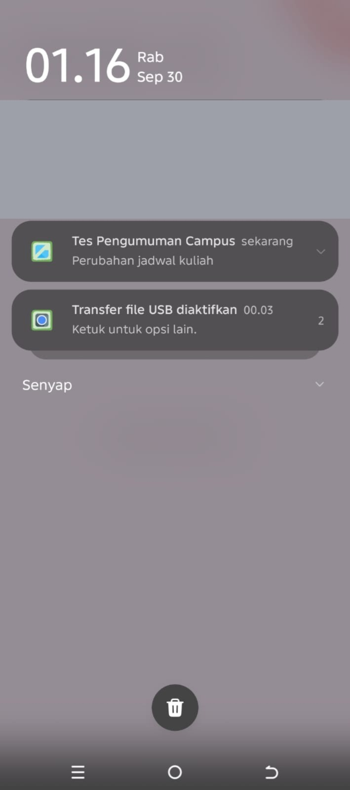
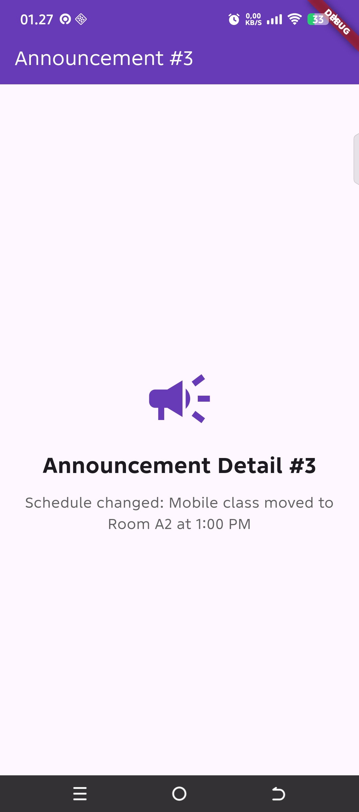
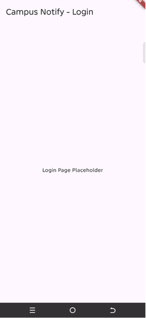
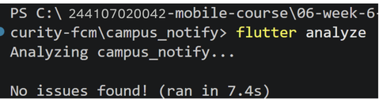
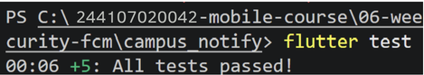

# Campus Notify 📢

Campus Notify merupakan aplikasi mobile berbasis Flutter yang digunakan untuk menyampaikan pengumuman kampus dan notifikasi secara real-time kepada mahasiswa. Aplikasi ini menggunakan **Firebase Cloud Messaging (FCM)**, **Flutter Local Notifications**, **Riverpod**, **GoRouter**, dan **Flutter Secure Storage**.

---

## 📱 Deskripsi Aplikasi & Autentikasi

### Deskripsi Aplikasi

Campus Notify memungkinkan mahasiswa menerima pengumuman kampus dan notifikasi secara real-time pada berbagai kondisi aplikasi, yaitu saat aplikasi sedang dibuka, berjalan di latar belakang, maupun dalam keadaan ditutup sepenuhnya.

### Autentikasi & Route Guard

* Token autentikasi (`access_token` dan `refresh_token`) disimpan secara aman menggunakan **FlutterSecureStorage** pada `lib/data/token_store.dart`.
* **GoRouter** digunakan untuk menerapkan perlindungan pada rute aplikasi melalui `lib/main.dart`. Pengguna yang belum terautentikasi akan diarahkan ke halaman `/login`.
* **Dio interceptor** pada `lib/data/api_client.dart` secara otomatis mencoba memperbarui JWT access token ketika menerima respons HTTP `401`.
* Jika proses pembaruan token gagal, data autentikasi yang tersimpan akan dihapus dan pengguna akan dikeluarkan dari aplikasi.

---

## 🧪 Pengujian FCM pada Berbagai Kondisi Aplikasi

Fitur notifikasi FCM telah diuji pada tiga kondisi siklus hidup aplikasi menggunakan payload berikut:

```json
{"route": "/announcement/3"}
```

| **Kondisi Aplikasi** | **Hasil yang Diharapkan**                                                                                                           | **Cara Pengujian**                                                                                                  | **Status**   |
| -------------------- | ----------------------------------------------------------------------------------------------------------------------------------- | ------------------------------------------------------------------------------------------------------------------- | ------------ |
| **Foreground**       | Banner notifikasi lokal muncul. Ketika notifikasi ditekan, pengguna diarahkan ke `/announcement/3`.                                 | Buka aplikasi dan biarkan tetap berada di layar, kemudian kirim pesan FCM melalui Firebase Console atau backend.    | **BERHASIL** |
| **Background**       | Banner notifikasi sistem Android muncul. Ketika notifikasi ditekan, aplikasi terbuka dan mengarahkan pengguna ke `/announcement/3`. | Tekan tombol Home untuk menjalankan aplikasi di latar belakang, kirim pesan FCM, lalu tekan notifikasi yang muncul. | **BERHASIL** |
| **Terminated**       | Aplikasi dibuka kembali dari kondisi tertutup menggunakan `getInitialMessage()` dan langsung diarahkan ke `/announcement/3`.        | Tutup aplikasi sepenuhnya, kirim pesan FCM, lalu tekan notifikasi yang diterima.                                    | **BERHASIL** |

---

## 📸 Bukti Screenshot




## 🚀 Cara Menjalankan Aplikasi

1. Hubungkan perangkat Android fisik melalui USB dan pastikan **USB Debugging** telah diaktifkan.
2. Ambil seluruh dependency dan lakukan pemeriksaan kode dengan menjalankan:

   ```bash
   flutter pub get
   flutter analyze
   ```
3. Jalankan unit test dan widget test:

   ```bash
   flutter test
   ```
4. Build dan jalankan aplikasi pada perangkat Android yang telah terhubung:

   ```bash
   flutter run
   ```

---

## 🤖 Tools AI yang Digunakan

* **Google Antigravity AI Assistant (Gemini 3.6 Flash)**: Digunakan untuk membantu merancang arsitektur FCM, mengimplementasikan `PushService`, melakukan refactoring pada route guard, serta membuat test suite.

---

## 💬 Prompt dan Perbaikan Manual

### Prompt yang Digunakan

> *Flutter Campus Notification App. Stack: firebase_messaging, flutter_local_notifications, flutter_secure_storage, go_router, Riverpod. Generate a PushService with: requestPermission + getToken + onTokenRefresh (send to POST /devices), onMessage (show a local notification manually), onMessageOpenedApp + getInitialMessage (navigate to data.route), subscribe/unsubscribe topic campus-announcement, top-level background handler with @pragma('vm:entry-point'). Mark which parts DIFFER for Android 13+ vs iOS, and which parts must never touch BuildContext.*

### Perbaikan Manual yang Diterapkan

1. **Permission Notifikasi Android 13+ dan Desugaring**
   Menambahkan permission `<uses-permission android:name="android.permission.POST_NOTIFICATIONS"/>` pada `AndroidManifest.xml` dan mengaktifkan `isCoreLibraryDesugaringEnabled = true` pada `build.gradle.kts`.

2. **Perbaikan GoRouter untuk Deep Link**
   Memperbarui logika `redirect` pada `lib/main.dart` agar rute pengumuman publik (`/announcement/:id`) tetap dapat diakses tanpa diarahkan ke `/login`.

3. **Perbaikan Sintaks dan Callback Local Notification**
   Memperbaiki penulisan parameter `InitializationSettings` menjadi `settings:` serta menghubungkan callback `_onRouteTap` agar navigasi ke rute tujuan dapat dilakukan secara langsung ketika notifikasi ditekan.


## ⚠️ Masalah yang Ditemukan & Hasil Pengujian

### Masalah yang Ditemukan dan Diselesaikan

* **Kegagalan Build (Desugaring)**: Proses build `flutter_local_notifications` mengalami kegagalan karena konfigurasi Java 8 desugaring belum diaktifkan pada Android Gradle. Masalah ini diperbaiki melalui konfigurasi pada `build.gradle.kts`.
* **Navigasi Tidak Berjalan**: Ketika notifikasi diterima dalam kondisi foreground, penekanan pada notifikasi tidak berhasil memicu navigasi menggunakan GoRouter. Masalah ini diperbaiki dengan menerapkan `routeFromMessage` dan callback `listenForeground`.

### Verifikasi & Hasil Pengujian



## 📝 Reflection

### Q1: Mengapa refresh token tidak boleh disimpan di SharedPreferences? Apa risikonya jika token tersebut bocor?

* **Jawaban Teknis**: `SharedPreferences` pada Android menyimpan data dalam file XML yang tidak terenkripsi (`/data/data/<package>/shared_prefs/`). Jika perangkat memiliki akses root atau data dapat diambil melalui metode ekstraksi backup tertentu, token yang tersimpan dapat dibaca. Sebaliknya, `FlutterSecureStorage` menggunakan mekanisme keamanan seperti Android Keystore dan iOS Keychain untuk melindungi data sensitif.
* **Risiko Jika Bocor**: Refresh token biasanya memiliki masa berlaku yang lebih panjang, bahkan dapat mencapai beberapa minggu atau bulan. Jika penyerang memperoleh refresh token, mereka dapat menggunakannya untuk menghasilkan access token yang valid tanpa mengetahui kata sandi pengguna. Hal ini dapat menyebabkan pengambilalihan akun secara berkelanjutan.

### Q2: Apa yang terjadi jika `onTokenRefresh` diabaikan selama satu semester?

* **Jawaban Teknis**: FCM registration token dapat berubah atau menjadi tidak valid secara berkala, misalnya setelah pemulihan data aplikasi, pembaruan sistem operasi, atau perubahan pada Google Play Services.
* **Konsekuensi**: Jika perubahan token melalui `onTokenRefresh` tidak ditangani, backend dapat tetap menyimpan token lama. Akibatnya, notifikasi penting seperti informasi ujian, pengumuman nilai, atau pengingat pembayaran UKT tidak dapat diterima oleh perangkat tersebut dan dapat menghasilkan error seperti `NotRegistered` atau `UNREGISTERED`.

### Q3: Kapan menggunakan topic dan kapan menggunakan device token? Berikan masing-masing satu contoh pesan kampus.

* **Topic Messaging**: Digunakan untuk mengirim notifikasi secara massal kepada kelompok pengguna atau seluruh pengguna tanpa harus mengelola token perangkat satu per satu.

  * **Contoh**: *"Kampus Libur: Seluruh kegiatan perkuliahan ditiadakan pada hari libur nasional besok."*
  * **Topic**: `campus-announcement`

* **Device Token Messaging**: Digunakan untuk mengirim notifikasi yang bersifat spesifik, personal, atau sensitif kepada perangkat pengguna tertentu.

  * **Contoh**: *"Pemberitahuan Khusus: Pembayaran UKT Semester Genap atas nama [Nama Mahasiswa] telah diverifikasi LUNAS."*
  * **Target**: Device Token pengguna terkait.

### Q4: Bagian mana dari draft AI yang ditolak atau diperbaiki, dan mengapa?

Beberapa bagian dari draft awal AI perlu diperbaiki agar sesuai dengan kebutuhan aplikasi dan konfigurasi Android:

1. **Permission Android 13+ & Desugaring**
   Draft awal belum menambahkan `POST_NOTIFICATIONS` pada `AndroidManifest.xml` dan `isCoreLibraryDesugaringEnabled` pada konfigurasi Gradle. Tanpa konfigurasi tersebut, proses build dapat mengalami kegagalan dan notifikasi dapat tidak muncul pada perangkat Android 13+.

2. **GoRouter Guard yang Menghambat Deep Link**
   Route guard pada draft awal mengarahkan pengguna yang belum terautentikasi ke `/login`, termasuk ketika pengguna membuka deep link menuju halaman pengumuman. Logika redirect kemudian diperbaiki agar rute publik seperti `/announcement/:id` tetap dapat diakses.

3. **Callback Banner pada Kondisi Foreground**
   Terdapat masalah pada konfigurasi `InitializationSettings` dan callback ketika pengguna menekan notifikasi lokal. Perbaikan dilakukan pada sintaks parameter `InitializationSettings` dan dengan menghubungkan callback `_onRouteTap` agar penekanan notifikasi dapat menjalankan `router.go(route)` sesuai rute yang diterima.
