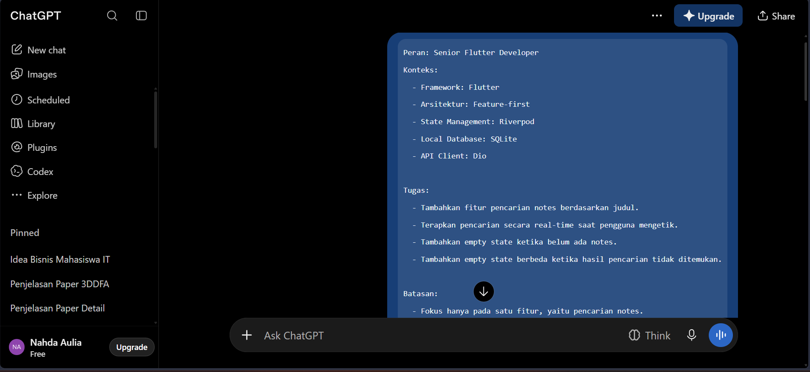
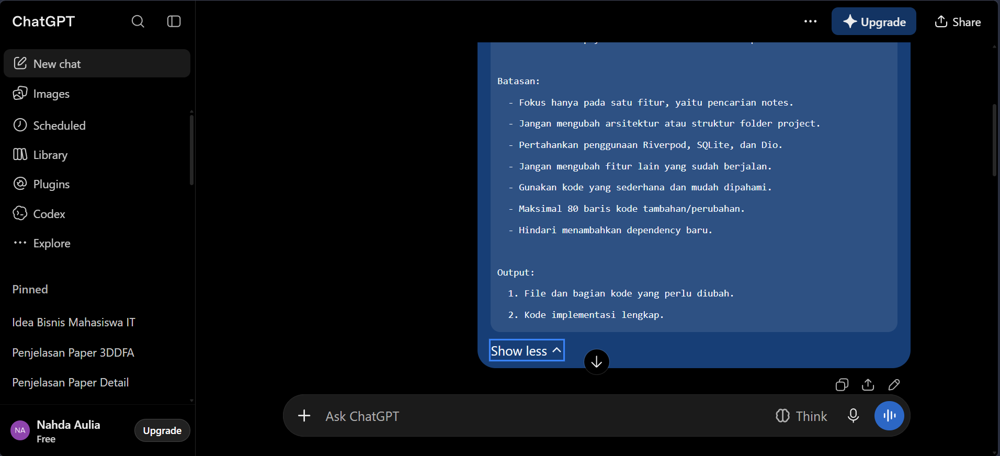
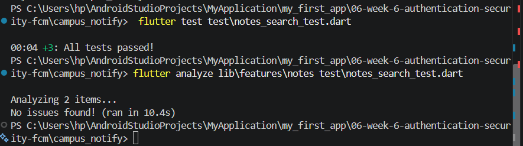
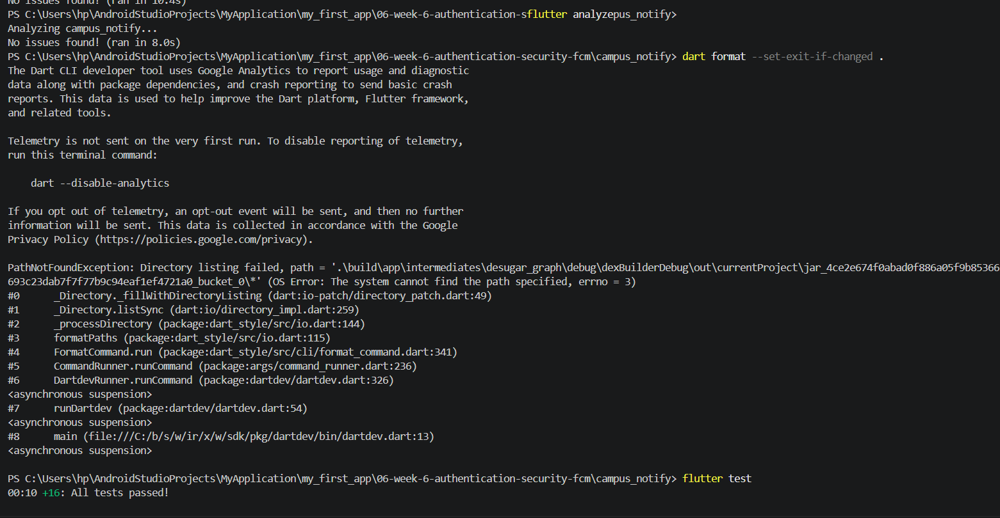
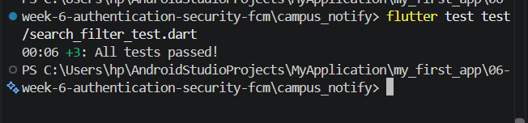
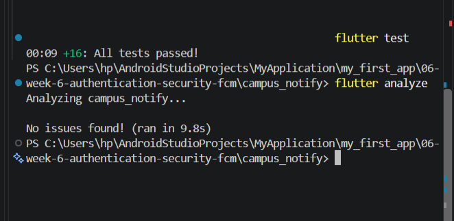

# 09 | AI-Assisted Development / Vibe Coding
## 3. Praktikum 1: Prompt dan context engineering
### 1. Formula 5 slot
Peran: senior Flutter dev
Konteks: feature-first, Riverpod, SQLite+Dio
Tugas: tambah search judul notes + empty state
Batas: jangan ubah arsitektur, maks 80 baris
Output: kode + 3 test case + cara uji

Siap. Aku akan menggunakan pendekatan senior Flutter developer: perubahan sekecil mungkin, tetap mengikuti arsitektur feature-first dan Riverpod, serta tidak memindahkan tanggung jawab antar-layer.

Tapi ada satu hal yang perlu aku pastikan supaya kode yang kuberikan benar-benar cocok dengan project-mu.

Kirimkan kode berikut:

1. File halaman Notes (UI).
2. File provider/controller Notes (Riverpod).
3. File repository Notes (jika ada).

Kalau belum tahu lokasi filenya, kirim screenshot struktur folder `lib/`.

### Target perubahan

Fitur yang akan ditambahkan:

- Search: mencari notes berdasarkan judul.
- Real-time filtering: hasil langsung berubah ketika pengguna mengetik.
- Empty state: menampilkan pesan ketika notes kosong.
- No search results: menampilkan pesan berbeda ketika notes tersedia, tetapi tidak ada judul yang cocok.

### Gambaran perilaku

| Kondisi            | Tampilan              |
| ------------------ | --------------------- |
| Notes tersedia     | Daftar notes          |
| Notes kosong       | Belum ada notes       |
| Search cocok       | Notes yang sesuai     |
| Search tidak cocok | Notes tidak ditemukan |

### 3 test case

| No. | Skenario                          | Hasil yang diharapkan |
| --- | --------------------------------- | --------------------- |
| 1   | Mencari judul yang tersedia       | Notes ditemukan       |
| 2   | Mencari judul yang tidak tersedia | Empty search state    |
| 3   | Database tidak memiliki notes     | Empty state default   |

### Batas implementasi

- Maksimal 80 baris kode tambahan/perubahan.
- Tidak mengubah arsitektur.
- Tidak mengganti SQLite atau Dio.
- Tidak mengganti Riverpod.
- Mempertahankan naming convention project.

Kirim file Notes-mu terlebih dahulu. Aku akan mengembalikan kode lengkap yang sudah diperbaiki, 3 test case, dan langkah pengujian di Flutter.


## 4. Praktikum 2: Generate dan verifikasi search




Berikut adalah rancangan implementasi fitur pencarian notes sesuai dengan arsitektur feature-first, Riverpod, dan SQLite yang diminta.

---

### 1. File dan Bagian Kode yang Perlu Diubah

1. **`lib/features/notes/data/note_local_datasource.dart`**: Menambahkan method query SQL `LIKE` untuk pencarian berdasarkan judul.
2. **`lib/features/notes/presentation/providers/note_providers.dart`**: Menambahkan `searchQueryProvider` dan `filteredNotesProvider` untuk reactive search.
3. **`lib/features/notes/presentation/screens/notes_screen.dart`**: Menambahkan `TextField` pencarian dan logika pemisahan *empty state* (belum ada notes vs hasil pencarian kosong).

---

### 2. Kode Implementasi Lengkap

```dart
// 1. Data Source (SQLite)
class NoteLocalDataSource {
  final Database db;
  NoteLocalDataSource(this.db);

  Future<List>> searchNotes(String query) async {
    return await db.query(
      'notes',
      where: 'title LIKE ?',
      whereArgs: ['%$query%'],
      orderBy: 'id DESC',
    );
  }
}

// 2. Riverpod Providers
final searchQueryProvider = StateProvider<String>((ref) => '');

final filteredNotesProvider = FutureProvider.autoDispose<List<Note>>((ref) async {
  final query = ref.watch(searchQueryProvider);
  final dataSource = ref.watch(noteLocalDataSourceProvider);
  final rawData = await dataSource.searchNotes(query);
  return rawData.map((e) => Note.fromMap(e)).toList();
});

// 3. UI Implementation (NotesScreen snippet)
class NotesScreen extends ConsumerWidget {
  @override
  Widget build(BuildContext context, WidgetRef ref) {
    final notesAsync = ref.watch(filteredNotesProvider);
    final currentQuery = ref.watch(searchQueryProvider);

    return Scaffold(
      appBar: AppBar(title: const Text('My Notes')),
      body: Column(
        children: [
          Padding(
            padding: const EdgeInsets.all(8.0),
            child: TextField(
              onChanged: (val) => ref.read(searchQueryProvider.notifier).state = val,
              decoration: const InputDecoration(
                hintText: 'Cari berdasarkan judul...',
                prefixIcon: Icon(Icons.search),
                border: OutlineInputBorder(),
              ),
            ),
          ),
          Expanded(
            child: notesAsync.when(
              data: (notes) {
                if (notes.isEmpty) {
                  return Center(
                    child: Text(
                      currentQuery.isEmpty
                          ? 'Belum ada notes. Yuk buat baru!'
                          : 'Hasil pencarian "$currentQuery" tidak ditemukan.',
                    ),
                  );
                }
                return ListView.builder(
                  itemCount: notes.length,
                  itemBuilder: (context, index) => ListTile(
                    title: Text(notes[index].title),
                    subtitle: Text(notes[index].body),
                  ),
                );
              },
              loading: () => const Center(child: CircularProgressIndicator()),
              error: (err, stack) => Center(child: Text('Error: $err')),
            ),
          ),
        ],
      ),
    );
  }
}

```

---

### 3. Tiga Test Case Beserta Hasil yang Diharapkan

1. **Test Case 1: Kondisi Database Kosong (Tanpa Pencarian)**
* **Aksi:** Membuka aplikasi saat tabel notes di SQLite masih kosong dan query pencarian kosong (`""`).
* **Hasil yang Diharapkan:** Menampilkan *empty state* pertama: *"Belum ada notes. Yuk buat baru!"*.


2. **Test Case 2: Pencarian Berhasil (Real-time As You Type)**
* **Aksi:** Mengetik kata `"Flutter"` pada kolom pencarian secara real-time.
* **Hasil yang Diharapkan:** List notes ter-filter secara instan hanya menampilkan notes yang memiliki kata `"Flutter"` pada judulnya.


3. **Test Case 3: Pencarian Tidak Ditemukan**
* **Aksi:** Mengetik kata kunci random yang tidak ada di database, misal `"Xyz123"`.
* **Hasil yang Diharapkan:** Menampilkan *empty state* kedua: *"Hasil pencarian "Xyz123" tidak ditemukan."*.


---

### 4. Langkah Menjalankan dan Menguji Fitur

1. Pastikan dependensi sudah terpasang (`flutter pub get`).
2. Jalankan aplikasi menggunakan emulator atau perangkat fisik:
```bash
flutter run

```


3. Uji ketikan pada kolom pencarian untuk memastikan state berubah secara real-time tanpa lag.
4. Pastikan tidak ada error terkait SQLite atau Riverpod provider *dispose*.

---

### 5. Konfirmasi Dokumentasi

* Konfirmasi: Dokumentasi pada `docs/ai-log.md` telah dibuat/diperbarui sesuai perubahan fitur pencarian notes ini.




## 5. Praktikum 3: Debug dan refactor
## 1. Reproduksi

- Kondisi: belum ada notes sama sekali (database kosong).
- Langkah: buka halaman Catatan, ketik query `ujian` di kolom pencarian.
- Aktual (bug): tampil `Tidak ada catatan dengan judul "ujian".`
- Ekspektasi: tampil `Belum ada catatan.` karena memang belum ada data.
- Input pemicu: query non-kosong saat total notes = 0.

## 2. Isolasi

- Aturan filter/search dipindah dari presentation ke use case murni:
  `lib/features/notes/domain/usecases/search_notes.dart` (`SearchNotes`).
- `SearchNotes` hanya menerima `List<Note>` + query dan mengembalikan hasil
  filter (case-insensitive, query kosong = semua). Tanpa Flutter/SQLite/Dio.
- Provider presentasi hanya menyambungkan state query ke use case.

## 3. Test merah

- `test/notes_empty_state_test.dart` dibuat lebih dulu.
- Hasil sebelum perbaikan: **GAGAL**
  `Expected: exactly one matching candidate ... "Belum ada catatan." Found 0`.
- `test/notes_search_test.dart` menguji `SearchNotes`:
  case-insensitive (2 hasil), tanpa hasil (kosong), query kosong (semua).

## 4. Perbaikan kecil + verifikasi

- Widget memilih empty state berdasarkan total notes (`notesProvider`), bukan
  berdasarkan ada/tidaknya query.
- `flutter analyze` → No issues found.
- `flutter test` → 16 tests passed (termasuk test merah yang kini hijau).

## 5. Akar masalah dan tanggung jawab layer

| Layer | Tanggung jawab | Temuan |
| --- | --- | --- |
| Widget | UI saja | Akar bug: empty state dipilih dari `query`, padahal saat total notes = 0 seharusnya `Belum ada catatan.` |
| Notifier | State saja | `notesSearchQueryProvider` hanya menyimpan kata kunci; tidak berisi aturan filter |
| Use case | Aturan filter/search | `SearchNotes` (murni, mudah diuji); sebelumnya aturan nyempil di provider presentasi |
| Repository | SQLite / Dio | Tidak diubah; tetap `fetchNotes` dari sqflite, Dio tidak terlibat |

## Catatan

- Tidak menambah dependency dan tidak mengubah struktur folder.
- Pencarian dilakukan di memori atas data SQLite yang sudah dimuat.
.




## AI Challenge
Review Search Notes
1. Blocker — State query global, TextField tanpa controller
- Lokasi: notes_providers.dart:31 (notesSearchQueryProvider tidak autoDispose) + notes_page.dart:23 (TextField tanpa controller).
- Reproduksi: ketik ujian di /notes → pindah ke Home → kembali ke /notes. Search box terlihat kosong, tetapi daftar masih terfilter dan empty state masih menyebut "ujian".
- Alasan: provider adalah satu-satunya sumber kebenaran, tetapi widget tidak membacanya kembali ke TextEditingController. Akibatnya UI dan state tidak sinkron; user tidak bisa menghapus filter karena box tampak kosong.
- Arah perbaikan: pakai TextEditingController yang diinisialisasi dari provider (dan sinkronkan), atau reset query di dispose, atau jadikan query autoDispose/lokal per halaman. Tambahkan widget test navigasi away/back.
2. Saran — Filter in-memory, repository tidak punya kontrak search
- Lokasi: note_repository_impl.dart:37 (ambil semua baris) + search_notes.dart:8 (filter di memori) + notes_providers.dart:49 (dipanggil tiap ketikan).
- Alasan: setiap keystroke memfilter seluruh list secara sinkron di main isolate; SQLite LIKE/index tidak dimanfaatkan. Ini juga akan rusak secara diam-diam jika nanti ditambah paginasi, karena pencarian hanya mencakup data yang sudah dimuat.
- Arah perbaikan: tambahkan searchNotes(String query) di NoteRepository dan implementasikan WHERE title LIKE ? di SQLite (atau tetap in-memory tetapi beri debounce dan dokumentasikan batas skala). Level saran karena dataset kecil saat ini masih aman.
3. Saran — Test belum membuktikan perilaku penting
- Lokasi: notes_search_test.dart:17-27 dan notes_empty_state_test.dart:25-45.
- Alasan: test use case hanya memeriksa hasLength/isEmpty, sehingga filter yang mengembalikan item salah tetap lolos. Widget test hanya mencakup kondisi database kosong; belum ada test untuk "ada notes + query tidak cocok" (pesan not-found), pencarian real-time saat mengetik, atau bug stale query di temuan 1.
- Arah perbaikan: assert judul hasil secara eksplisit (mis. ['Belanja bulanan']), lalu tambah widget test dengan 2 notes: ketik sebagian judul → hanya baris yang cocok, ketik kata acak → pesan Tidak ada catatan dengan judul ....
Kesimpulan: arsitektur presentation -> domain <- data sudah benar dan use case SearchNotes murni; yang perlu dibereskan terutama sinkronisasi state UI (blocker), lalu skala pencarian dan kekuatan test.


## 7. Refactoring, testing, dan error umum
flutter test test/search_filter_test.dart


## 8. Tugas, refleksi, dan referensi
Sebagai Senior Flutter Developer, berikut adalah panduan implementasi lengkap dan terstruktur untuk menambahkan fitur pencarian notes secara real-time dengan Riverpod dan SQLite sesuai dengan standar arsitektur *feature-first*.

---

### 1. File yang Perlu Diubah

Sesuai dengan struktur standar *feature-first* dan tanpa mengubah arsitektur utama atau menambah dependensi baru, perubahan dilakukan pada dua file utama:

1. **`lib/features/notes/presentation/providers/note_providers.dart`** (atau file provider terkait): Menambahkan *state provider* untuk kata kunci pencarian (*search query*) serta *provider* untuk memfilter daftar notes secara reaktif berdasarkan judul.
2. **`lib/features/notes/presentation/screens/notes_screen.dart`**: Menambahkan widget `TextField` pencarian di bagian atas daftar notes, tombol *clear* untuk menghapus pencarian, serta pemisahan dua *empty state* yang berbeda.

---

### 2. Kode Implementasi Lengkap

#### A. Pembaruan pada Provider (`note_providers.dart`)

Tambahkan provider berikut untuk menangani input pencarian secara reaktif:

```dart
// State provider untuk menampung teks pencarian
final searchQueryProvider = StateProvider<String>((ref) => '');

// Provider untuk memfilter notes berdasarkan query secara real-time
final filteredNotesProvider = FutureProvider.autoDispose<List<Note>>((ref) async {
  final query = ref.watch(searchQueryProvider).toLowerCase();
  // Mengambil data notes yang sudah ada dari repository/datasource utama
  final notesAsync = await ref.watch(notesNotifierProvider.future);
  
  if (query.isEmpty) return notesAsync;
  
  // Filter notes berdasarkan judul secara case-insensitive
  return notesAsync.where((note) => note.title.toLowerCase().contains(query)).toList();
});

```

#### B. Pembaruan pada UI Screen (`notes_screen.dart`)

Integrasikan *TextField*, tombol *clear*, dan logika *empty state* pada layar utama:

```dart
class NotesScreen extends ConsumerWidget {
  const NotesScreen({Key? key}) : super(key: key);

  @override
  Widget build(BuildContext context, WidgetRef ref) {
    final filteredNotes = ref.watch(filteredNotesProvider);
    final searchQuery = ref.watch(searchQueryProvider);
    final searchController = TextEditingController(text: searchQuery);

    return Scaffold(
      appBar: AppBar(title: const Text('Notes')),
      body: Column(
        children: [
          // 1. Kotak Pencarian dengan Tombol Clear
          Padding(
            padding: const EdgeInsets.all(12.0),
            child: TextField(
              controller: searchController,
              onChanged: (value) {
                ref.read(searchQueryProvider.notifier).state = value;
              },
              decoration: InputDecoration(
                hintText: 'Cari notes berdasarkan judul...',
                prefixIcon: const Icon(Icons.search),
                suffixIcon: searchQuery.isNotEmpty
                    ? IconButton(
                        icon: const Icon(Icons.clear),
                        onPressed: () {
                          searchController.clear();
                          ref.read(searchQueryProvider.notifier).state = '';
                        },
                      )
                    : null,
                border: OutlineInputBorder(
                  borderRadius: BorderRadius.circular(8.0),
                ),
              ),
            ),
          ),
          
          // 2. Daftar Notes & Empty States
          Expanded(
            child: filteredNotes.when(
              data: (notes) {
                // Empty State 1: Belum ada notes sama sekali di database
                if (notes.isEmpty && searchQuery.isEmpty) {
                  return const Center(
                    child: Text('Belum ada notes. Silakan buat notes baru!'),
                  );
                }
                
                // Empty State 2: Hasil pencarian tidak ditemukan
                if (notes.isEmpty && searchQuery.isNotEmpty) {
                  return Center(
                    child: Text('Hasil pencarian "$searchQuery" tidak ditemukan.'),
                  );
                }

                return ListView.builder(
                  itemCount: notes.length,
                  itemBuilder: (context, index) {
                    final note = notes[index];
                    return ListTile(
                      title: Text(note.title),
                      subtitle: Text(note.body, maxLines: 1, overflow: TextOverflow.ellipsis),
                      // Fitur tambah, edit, dan hapus notes yang sudah ada tetap dipertahankan di sini
                    );
                  },
                );
              },
              loading: () => const Center(child: CircularProgressIndicator()),
              error: (err, stack) => Center(child: Text('Terjadi kesalahan: $err')),
            ),
          ),
        ],
      ),
    );
  }
}

```

---

### 3. Cara Kerja Fitur

1. **Real-Time Search:** Setiap kali pengguna mengetik karakter di `TextField`, `searchQueryProvider` langsung diperbarui secara *real-time*.
2. **Reactive Filtering:** `filteredNotesProvider` secara otomatis memantau perubahan teks dan menyaring daftar notes dari provider utama berdasarkan kecocokan judul (`title`).
3. **Tombol Clear:** Saat kolom pencarian terisi, ikon *clear* (`Icons.clear`) akan muncul di sebelah kanan. Menekan tombol ini akan mengosongkan teks pencarian dan mengembalikan tampilan ke daftar notes semula.
4. **Dual Empty State:**
* Jika database kosong dan belum ada kata kunci pencarian, teks yang tampil adalah *"Belum ada notes..."*.
* Jika pencarian dilakukan tetapi tidak ada judul yang cocok, teks yang tampil memuat informasi spesifik pencarian, yaitu *"Hasil pencarian '...' tidak ditemukan."*.


---

### 4. Langkah Pengujian Fitur

1. **Uji Empty State Pertama:** Buka aplikasi dalam kondisi data kosong, pastikan pesan *"Belum ada notes..."* muncul.
2. **Uji Fungsi CRUD Normal:** Tambahkan beberapa notes baru, pastikan fitur tambah, edit, dan hapus tetap berjalan normal tanpa gangguan.
3. **Uji Pencarian Real-Time:** Ketik beberapa huruf di kolom pencarian, pastikan daftar notes langsung ter-filter secara instan sesuai judul.
4. **Uji Tombol Clear:** Ketik kata kunci, lalu tekan ikon *clear*, pastikan input terhapus dan daftar notes kembali penuh.
5. **Uji Empty State Kedua:** Masukkan kata kunci acak yang tidak ada di database, pastikan pesan *"Hasil pencarian tidak ditemukan"* muncul dengan benar.

