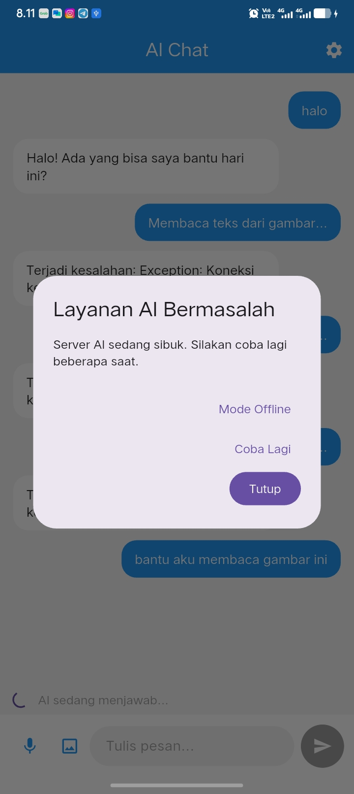
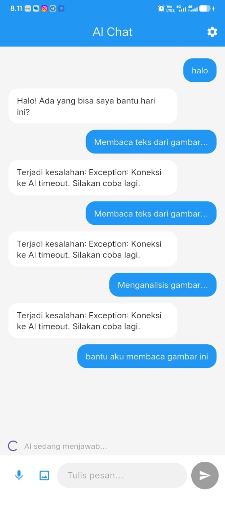

# 10 | Integrasi Fitur AI

## Refleksi
1. Fitur AI mana yang Anda integrasikan dan mengapa?
Saya mengintegrasikan fitur AI Chat menggunakan model Gemini Flash. Fitur ini memungkinkan pengguna mengirim pertanyaan dan mendapatkan jawaban secara otomatis. Selain itu, saya juga mengembangkan fitur OCR untuk membaca teks dari gambar dan Image Understanding untuk memahami isi gambar. Fitur ini dipilih agar aplikasi lebih interaktif dan membantu pengguna memperoleh informasi dengan mudah.
2. Bagaimana Anda melindungi privasi pengguna saat menggunakan AI API?
Saya menyimpan API Key menggunakan FlutterSecureStorage agar tidak disimpan secara langsung di dalam kode aplikasi. Saya juga membatasi data yang dikirim ke AI API dan menyarankan pengguna untuk tidak mengirimkan informasi sensitif, seperti kata sandi atau data pribadi.
3. Fallback apa yang Anda sediakan jika layanan AI error?
Jika layanan AI mengalami error atau sedang sibuk, aplikasi menampilkan pesan yang mudah dipahami, seperti “Server AI sedang sibuk, coba lagi nanti.” Pengguna dapat mencoba kembali setelah beberapa saat. Saya juga menyediakan rencana fallback berupa jawaban lokal sederhana untuk pertanyaan tertentu ketika layanan AI tidak tersedia.
4. Satu hal yang Anda pelajari tentang UX fitur AI di mobile?
Saya belajar bahwa fitur AI di aplikasi mobile harus memberikan feedback yang jelas. Pengguna perlu mengetahui ketika pesan sedang diproses, ketika jawaban berhasil diterima, atau ketika terjadi error. Dengan begitu, pengguna tidak merasa aplikasi sedang macet atau tidak merespons.