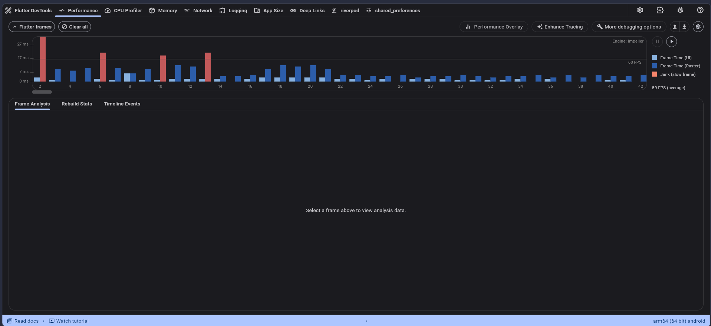
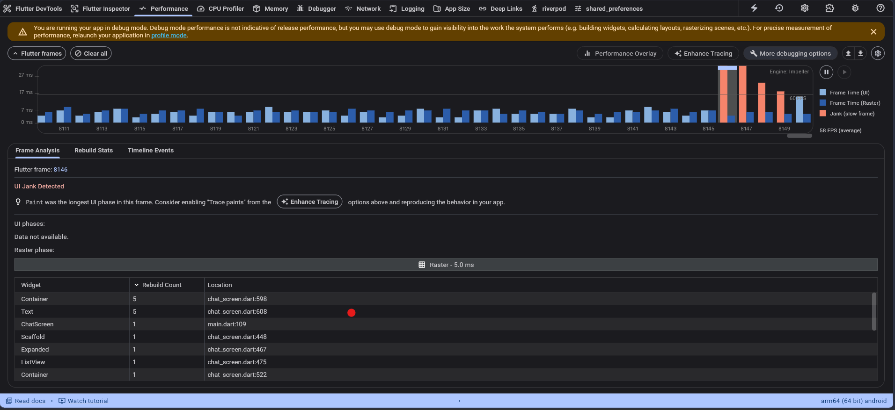

# Performance Findings - Week 11

## 1. Informasi Pengujian

- Project: campus_notify
- Praktikum: Week 11 - Performance Optimization
- Platform: Android
- Tools: Flutter DevTools
- Profiling mode: Debug Mode (karena recording dalam Profile Mode mengalami kendala)
- Tujuan: Mengidentifikasi masalah performa, menerapkan optimasi, dan memeriksa penggunaan memori.

## 2. Hasil Baseline Profiling

Berdasarkan pengamatan Flame Chart sebelum optimasi, ditemukan beberapa widget dengan frekuensi build tinggi.

Widget yang tercatat antara lain:
- Text: 608 kali
- Container: 608 kali
- Icon: 162 kali
- TextField: 137 kali
- AppBar: 134 kali
- Scaffold: 119 kali
- ListView: 111 kali

### Identifikasi Masalah

**1. Widget Rebuild Berlebihan**

Beberapa widget mengalami proses build berulang, terutama Text, Container, Icon, dan komponen pada halaman ChatScreen.

Dampaknya adalah pekerjaan tambahan pada UI Thread yang berpotensi menyebabkan frame rendering terlambat.

**2. Pemrosesan Gambar**

Pemrosesan gambar berukuran besar dapat menambah penggunaan memori dan waktu decoding.

Optimasi yang diterapkan adalah membatasi ukuran gambar ketika dipilih menggunakan ImagePicker.

**3. Pengelolaan Request AI**

Pemanggilan API AI dapat berulang ketika pertanyaan yang sama dikirim kembali.

Pemeriksaan kode AiService menunjukkan penggunaan cache in-memory untuk pertanyaan teks. Cache ini membantu menghindari request berulang untuk pertanyaan yang sama selama aplikasi masih berjalan.

## 3. Optimasi yang Diterapkan

Beberapa optimasi yang diterapkan dan diperiksa pada project:

1. **Const Constructor**
   Menggunakan const pada widget statis untuk mengurangi pembuatan objek widget yang tidak diperlukan.

2. **ListView.builder**
   Menggunakan ListView.builder pada daftar pesan chat agar item dibuat sesuai kebutuhan tampilan.

3. **Image Resizing**
   Membatasi ukuran gambar melalui ImagePicker:
   - maxWidth: 1280
   - maxHeight: 1280
   - imageQuality: 80

4. **API Response Cache**
   Menggunakan Map in-memory untuk menyimpan jawaban AI berdasarkan pertanyaan yang telah dikirim.

5. **Resource Disposal**
   Memastikan TextEditingController, ScrollController, dan AudioRecorder dibersihkan melalui dispose().

## 4. Hasil Verifikasi Profiling

Pengujian dilakukan kembali setelah optimasi dengan skenario penggunaan aplikasi yang sama.

Hasil pengamatan:
- FPS yang terlihat berada di sekitar 58-59 FPS.
- Masih ditemukan beberapa frame yang mengalami UI Jank.
- Pada salah satu frame yang dianalisis, fase Paint menjadi fase UI terlama.
- Raster phase pada frame tersebut tercatat 5,0 ms.

Catatan: Pengambilan hasil akhir dilakukan dalam Debug Mode karena kendala recording pada Profile Mode. Oleh karena itu, hasil ini merupakan pengamatan diagnostik dan bukan pengukuran performa Release Mode.

## 5. Hasil Memory Profiling

Pengujian dilakukan dengan mengambil dua Heap Snapshot dan melakukan navigasi berulang antara halaman daftar dan halaman detail.

### Perbandingan Heap Snapshot

| Indikator | Snapshot 1 | Snapshot 2 |
|---|---:|---:|
| Dart Heap | 116,1 MB | 118,3 MB |
| Reachable Heap | 86,8 MB | 88,2 MB |
| Matrix4 Instances | 38 | 18 |
| JGlobalReference | 10 | 10 |

### Hasil Diff Snapshot

Beberapa objek yang mengalami perubahan:
- AudioRecorder: +1 instance.
- Semaphore: +1 instance.
- _ChatMessage: +6 instance.
- RecordConfig: +1 instance.
- Matrix4: berkurang 20 instance.

### Pemeriksaan Memory Leak

Kode ChatScreen diperiksa untuk memastikan resource dilepaskan dengan benar.

Hasil pemeriksaan:
- AudioRecorder memiliki pemanggilan dispose().
- TextEditingController memiliki dispose().
- ScrollController memiliki dispose().
- File audio sementara dihapus setelah proses transkripsi selesai.

AudioRecorder masih direferensikan oleh _ChatScreenState selama halaman chat aktif. Hal ini belum cukup untuk membuktikan adanya memory leak.

Kesimpulan sementara: belum ditemukan bukti kuat adanya memory leak berdasarkan dua snapshot dan pemeriksaan kode.

## 6. Kesimpulan

Optimasi dilakukan untuk mengurangi pekerjaan UI yang tidak diperlukan, membatasi pemrosesan gambar, mengurangi request AI berulang, dan memastikan pengelolaan resource berjalan dengan baik.

Hasil pengujian menunjukkan aplikasi masih berjalan pada kisaran 58-59 FPS dalam pengamatan Debug Mode. Masih terdapat beberapa frame yang mengalami UI Jank sehingga optimasi belum dapat dinyatakan menghilangkan seluruh keterlambatan rendering.

Hasil Memory Profiling juga belum menunjukkan bukti kuat adanya memory leak.

Dengan demikian, optimasi dan pengujian telah dilakukan, dengan keterbatasan bahwa pengukuran akhir menggunakan Debug Mode, bukan Profile Mode.

## 7. Dokumentasi Screenshot

Screenshot yang disimpan:
- 
- 

Kedua screenshot digunakan sebagai dokumentasi pengamatan performa sebelum dan sesudah optimasi. Screenshot setelah optimasi diambil dalam Debug Mode karena kendala recording Profile Mode.